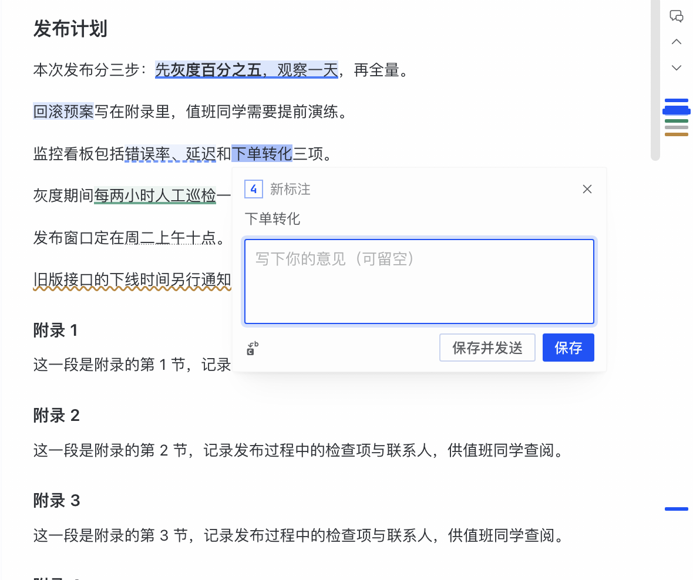
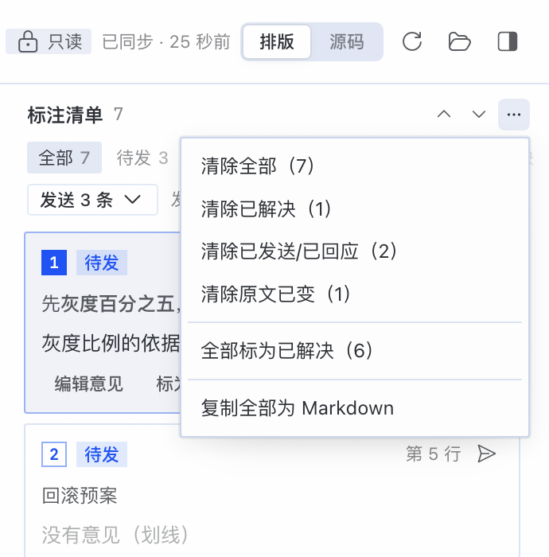
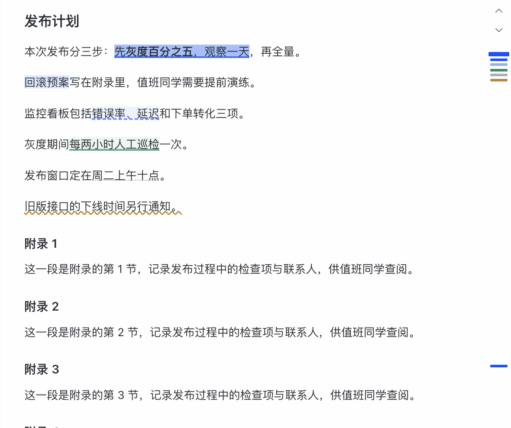
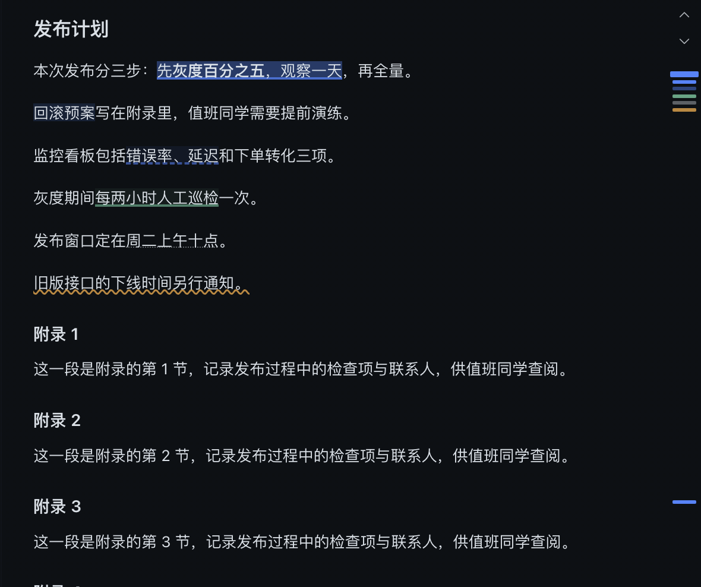
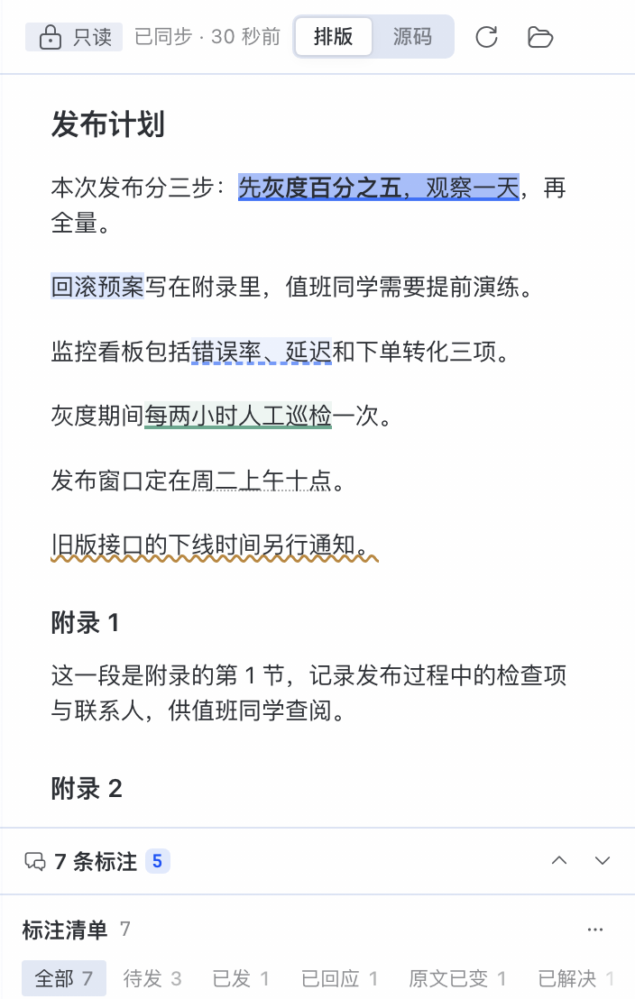

[English](README.md) | **简体中文** | [繁體中文](README.zh-hant.md) | [日本語](README.ja.md) | [العربية](README.ar.md) | [Русский](README.ru.md) | [Français](README.fr.md) | [Deutsch](README.de.md) | [Español](README.es.md)

# 圈批·文档（Diple Docs）— 在 Markdown 文档上划线、写批注，交给 AI（Hermes 桌面端插件）

在 Hermes 桌面端打开一份 `.md` 文件，划出段落、写上意见，再交给聊天里的 AI；每条标注都记住自己在文件里的位置，并显示待发、已发、已回应还是已解决。

> **名字的来历。** Diple（›）是古希腊抄本页边的标记，用来把一行文字指向它的注解。圈批·文档是这个家族里管文档的那一个；[圈批（Diple）](https://github.com/waiclay-349687/hermes-diple) 是管聊天的那一个。

> **非官方插件。** 这是社区插件，不是 Nous Research 或 Hermes Agent 项目制作、审核或支持的。

## 功能

- **只读的文档页**——在单独的标签页里打开 `.md` / `.markdown` 文件，位置和 Hermes 预览一致：停在聊天右侧。有「排版」和「源码」两种视图，还有「刷新」和「在访达中显示」。插件从不修改文档。
- **标注选中的文字**——选中文字后点「标注」。编辑浮层出现在原文正下方，所选原文带一层浅浅的临时底纹，看得出正在标哪一段。这时还没有新增任何条目。
- **保存后才进清单**——写了意见再点「保存」，得到一条*批注*（AI 必须回应）；空着点「保存」，得到一条*划线*（只有底纹）。保存之后才进入清单，并成为当前条。空草稿点外面或按 <kbd>Esc</kbd> 就被丢弃。写了字的草稿，点外面、切到别的条目、关闭或重载都不会丢；只有按 <kbd>Esc</kbd> 或点 × 才丢弃。文件刷新后，草稿跟着原文走；找不到原文时，会提示你重新选取。如果另一个窗口已经保存了同一段，可以选「保留已有」「用我的替换」或「合并」。
- **标注清单**——按文档顺序列出这个文件的全部标注，可以按「全部、待发、已发、已回应、原文已变、已解决」筛选。卡片上可以：跳回原文、编辑意见、标为已解决或重新打开、删除（可撤销）、单独发送这一条。
- **上一条 / 下一条未处理**——清单头部（以及页边状态条）的两个箭头，在还没解决的标注之间跳转。
- **批量清除，可撤销**——清单的「⋯」菜单可以清除全部、已解决、已发或已回应、原文已变或当前筛选出的条目，也可以全部标为已解决，或者全部复制为 Markdown。每一次清除都能撤销。
- **在工具栏里显示或隐藏清单**——开关在文档工具栏最右端（上面显示还有几条没处理）。隐藏后清单留下一条**页边状态条**：每条标注在文档中的位置画一个刻度，颜色表示状态；悬停刻度可以预览，点击就跳过去。
- **窄窗口**——页面太窄、清单放不下在文档旁边时，清单改成可以展开、折叠的底栏。
- **跟随文件变化**——磁盘上的文件变了，页面会重新载入（你正在写意见时会等你写完），并为每条标注重新找回原文。找不回来的标为「原文已变」，保留原来的文字，卡片上提供「重新选取原文」。
- **交给聊天**——「发送 N 条 ▾」把标注交给 [圈批](https://github.com/waiclay-349687/hermes-diple)：放进会话的待发列表，随你的下一条消息发出，或者立即发送。之后卡片显示「已发」，AI 回答后显示「已回应」，并附会话链接。同一个菜单里的「复制给 AI」则把它们复制成 Markdown。
- **聊天里的「用圈批·文档打开」卡片**——AI 写了 `.md` 文件后，回答末尾会出现一张卡片，点开就能标注（可以关掉）。最近的文档也在命令面板里。

插件界面支持 Hermes 桌面端的全部语言：**English、简体中文、繁體中文、日本語、العربية、Русский、Français、Deutsch 和 Español**（阿拉伯语从右到左）。默认跟随 app 的语言，也可以在插件设置里单独指定。

## 截图

所有截图都是简体中文界面，文档是虚构的示例。

编辑浮层出现在所选原文正下方；右侧是页边状态条：



清单头部：上一条 / 下一条未处理、展开的「⋯」批量菜单、筛选和最前面的几张卡片：



在工具栏里隐藏清单后：页边状态条上每条标注一个刻度（浅色和深色主题）：





窄页面：清单改成底栏：



截图是在沙箱里、编辑浮层最后一次改动之前拍的：那时新标注在浮层打开时就已经有编号；现在保存后才有。

## 安装

插件分两半：桌面插件（`plugin.js`）和一个小的 Python 后端（`plugins/diple-docs/`），两个都要装。要把标注发到聊天，还要装 [圈批](https://github.com/waiclay-349687/hermes-diple)（见下面的「姊妹插件」）。下面命令里的 `~/.hermes` 是你的 Hermes 主目录；用命名 profile 时换成 `~/.hermes/profiles/<name>`。

### 方式 A：下载发布版

1. 从[最新发布](https://github.com/waiclay-349687/hermes-diple-docs/releases)下载 `plugin.js`、`plugin.js.sha256`、`diple-docs-python-0.1.0.zip` 和 `diple-docs-python-0.1.0.zip.sha256`，然后校验：

   ```bash
   shasum -a 256 -c plugin.js.sha256
   shasum -a 256 -c diple-docs-python-0.1.0.zip.sha256
   ```

2. 放到对应位置：

   ```bash
   mkdir -p ~/.hermes/desktop-plugins/diple-docs ~/.hermes/plugins
   cp plugin.js ~/.hermes/desktop-plugins/diple-docs/plugin.js
   unzip -o diple-docs-python-0.1.0.zip -d ~/.hermes/plugins/
   ```

3. 启用后端，然后重启 Hermes 桌面端：

   ```bash
   hermes plugins enable diple-docs
   ```

### 方式 B：从源码安装

需要 Node.js 22 或更新版本。

```bash
git clone https://github.com/waiclay-349687/hermes-diple-docs.git
cd hermes-diple-docs
npm install
node scripts/install.mjs --home ~/.hermes --no-enable
hermes plugins enable diple-docs
```

`scripts/install.mjs` 会构建 `plugin.js`，并把两半复制进 `--home` 指定的 Hermes 主目录（它不会自己猜）。装完要重启 Hermes 桌面端：Python 那一半只在 app 启动时加载。

## 使用

1. 打开文档：在命令面板（<kbd>⌘K</kbd>）里选「圈批·文档：打开文档…」或「圈批·文档：最近的文档…」，或者在聊天里的「用圈批·文档打开」卡片上点「打开」。
2. 选中一段文字，点「标注」。写下意见，或者空着表示划线，然后点「保存」（或按 <kbd>Enter</kbd>；<kbd>Shift</kbd>+<kbd>Enter</kbd> 换行）。标注出现在清单里，原文上也有了底纹。
3. 继续往下看。用清单头部的箭头在还没处理的标注之间跳转；想要回宽度时，用工具栏的开关把清单收起来。
4. 打开「发送 N 条 ▾」：先选「这一条」或「本文件全部未发」，再选当前会话，加入它的待发列表或者立即发送。也可以选「复制给 AI」。
5. AI 回答后，卡片显示「已回应」。处理完的标为已解决，最后用「⋯」菜单清掉。

编辑浮层里的「保存并发送」会先保存，再把这一条发到当前会话。

### 快捷键

| 操作 | 默认 | 说明 |
| --- | --- | --- |
| 在文档页标注选中的文字 | <kbd>⌘⇧E</kbd> | 和圈批用同一个组合键，由文档页自己处理；也可以在 app 的快捷键设置里给「标注选中文字（文档页）」另绑一个键 |
| 显示或隐藏标注清单 | <kbd>⌘⌥B</kbd> | 可改绑 |
| 上一条 / 下一条未处理 | 无 | 在 app 的快捷键设置里绑定 |

日常操作的界面（按钮、浮层、清单、状态条）上不显示这些键帽，插件设置页里列出了全部快捷键。

在 Windows 和 Linux 上，<kbd>⌘</kbd> 对应 <kbd>Ctrl</kbd>。命令面板（<kbd>⌘K</kbd>）里还有「标注选中文字（文档页）」和「圈批·文档：设置」（显示为你的界面语言）。

## 设置

从命令面板（「圈批·文档：设置」）或 app 的设置里打开。

| 设置 | 默认 | 作用 |
| --- | --- | --- |
| 界面语言 | 跟随 app | 跟随 app，或九种语言之一，每种都用它自己的名字显示。 |
| AI 写了 `.md` 文件后附「用圈批·文档打开」卡片 | 开 | 回答末尾出现一张卡片，用来打开它写的文件。关掉后改从命令面板打开。 |
| 快捷键 | — | 页面列出上面的快捷键；改绑在 app 的快捷键设置里。 |
| 恢复默认 | — | 恢复默认设置。 |

## 工作原理

### AI 收到什么

圈批·文档自己不和 AI 打交道。「发送」通过插件事件把标注交给圈批（交接协议，见 [ADR 0007](docs/adr/README.md)）；圈批把它们放进会话的待发列表，和聊天里摘的标注排在一起，再按它自己的方式发出：聊天气泡保持简短，AI 收到的是每段原文的全文、所在文件和行号、你的意见，以及「每条意见都要回应」的规则。圈批会回报哪些发出去了、哪些得到了回应，卡片随之更新。

「复制给 AI」把同样的标注以 Markdown 形式放进剪贴板（原文作为引用，后面跟你的意见），可以用在任何聊天或工具里。

### 每条标注的位置

每条标注记下原文、行号和足够多的上下文，用来重新找到它。文件改动后，插件在新文本里找这段原文；如果上下文不够唯一、没有把握，就不去猜：这条标为「原文已变」，保留原来的文字。

### 数据存在哪里

- 标注、它们的状态以及最近的文档列表：SQLite，位于 `~/.hermes/plugin-data/diple-docs/data.db`，按文件路径区分。不会在你的文档旁边写任何文件。
- 布局选择（清单宽度、显示或隐藏、视图）：Hermes 桌面端的桌面插件存储（键名以 `hermes.plugin.diple-docs.` 开头）。

设计决策记录在 [docs/adr](docs/adr/README.md)，整体结构见 [docs/architecture.md](docs/architecture.md)。

## 隐私

所有数据都留在你的电脑上。插件自己不发任何网络请求，也没有遥测。它只读你打开的文档，并拒绝读取存放凭据或 Hermes 内部数据的位置（例如 `~/.ssh` 或 Hermes 的 `.env`）。只有你把标注发进会话时，它们才会到达模型服务商，和你自己打的字一样。

## 已知限制

主要几条（完整列表和原因见 [docs/known-limitations.md](docs/known-limitations.md)）：

- 发送需要圈批。没装时，第一次发送会等 3 秒回执（发到别的会话时等 10 秒，因为圈批要先切过去），然后页面提示圈批没有响应，并关闭发送；清单、意见、「复制给 AI」和「复制全部为 Markdown」照常可用。
- 发送目标只能是已有的会话：这里无法新建会话，因为 SDK 的 `newChat()` 不返回会话 id。_(issue not filed yet)_
- 在排版视图里，表格、原始 HTML 或脚注里的选区可能对不上源码；这时页面会请你切到源码视图重新选。
- 文件改名或移动后，清单从空开始。
- 如果另一个插件也会改写 AI 的回答，「用圈批·文档打开」卡片可能丢失（宿主只保留第一个改写结果）；文件仍然在「最近的文档」里。

## 兼容性

在 Hermes Agent **v0.22.5 (2026.9.24)**、提交 `bf0203a`（2026-10-22）、macOS 上测试，搭配圈批 0.2.2。需要 Hermes 桌面端（只有 CLI 时不会加载桌面插件）。其他版本也许能用，但没有测试过，欢迎反馈。

## 姊妹插件：圈批

[圈批（Diple）](https://github.com/waiclay-349687/hermes-diple) 是这个家族里管聊天的那一个：在对话里划出段落、写上意见，攒在输入框上方的待发列表里，随下一条消息发出；AI 逐条回应每条意见，你可以在回答和原文之间来回跳转。

- **没装圈批时**：打开文档、标注、清单、筛选、标为已解决、页边状态条、发送菜单里的「复制给 AI」和「复制全部为 Markdown」都能用；只有发送到会话需要圈批。
- **装了圈批后**：「发送 N 条 ▾」把文档里的标注放进会话的待发列表，和聊天里摘的标注一起，以胶囊的形式出现在输入框上方；它们随你的下一条消息发出；在菜单里直接选会话，则会马上发出。AI 的回答会标明在回应哪一条意见，这里的卡片随之变成「已发」，然后是「已回应」。

两者是独立的插件，各有仓库和发布版本，可以只装一个，也可以都装。运行时不共享任何代码：各自打包了一份共享核心。

## 与同类功能的区别

Hermes 桌面端自带的预览可以显示 Markdown 文件，也可以编辑。圈批·文档从不编辑：它是用来审阅的。它按文件保存标注清单、跨会话保留，文件改动后重新找回位置，跟踪每一条从待发到已回应再到已解决，并通过圈批交给聊天。

## 路线图与 issue

- [ROADMAP.md](ROADMAP.md)——正在做、接下来做和以后做的事。
- [Issues](https://github.com/waiclay-349687/hermes-diple-docs/issues)——待定问题、设计讨论和已知限制。
- [CHANGELOG.md](CHANGELOG.md)——每个版本的改动。
- [CONTRIBUTING.md](CONTRIBUTING.md)——构建和测试。

## 许可证

[MIT](LICENSE)。
